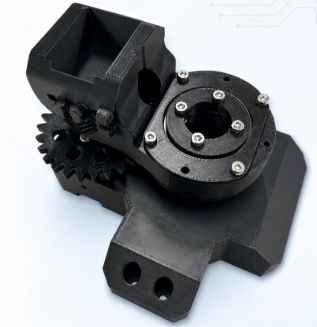
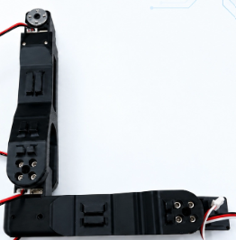
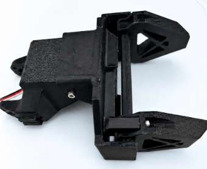
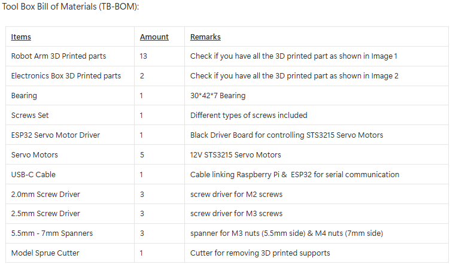
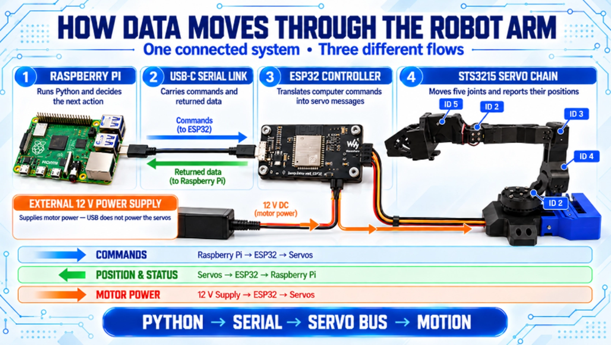

# Tic Tac Toe robotic_arm
A multi-joint robotic arm with a servo-driven gripper, designed for object manipulation and hands-on exploration of robotics, mechanical design, and control systems. This robotic arm also plays Tic-Tac-Toe remarkably well

[**Open Interactive 3D Model**](https://dimash-x.github.io/Tic-Tac-Toe_robotic_arm/)
## Overview

This project features a multi-joint robotic arm equipped with a servo-driven mechanical gripper, designed to perform object manipulation tasks and demonstrate practical applications of robotics and mechatronics

The robotic arm combines mechanical movement, servo-based actuation, and a gripping mechanism to interact with physical objects. One of its most interesting applications is playing Tic-Tac-Toe, where the robot physically picks up and places game pieces on the board

The project explores robotic manipulation, mechanical design, and control systems through an interactive engineering application

## Key Features

- **Multi-joint Robotic Arm:** Multiple articulated joints enable controlled movement and positioning.
- **Servo-Driven Gripper:** Mechanical gripper designed to pick up and handle objects.
- **Object Manipulation:** Performs physical pick-and-place operations.
- **Tic-Tac-Toe Gameplay:** Plays Tic-Tac-Toe by physically placing game pieces on the board.
- **Practical Robotics Application:** Combines mechanical design, actuation, and control systems in an interactive project.
## CAD Design

The robotic arm was designed and assembled in CAD. The three main assemblies were uploaded to the CAD environment for visualization. Screenshots of each assembly are shown below.

### 1. Base Assembly

### 2. Arm Body Assembly

### 3. Gripper Assembly

## Bill of Materials (BOM)

The Bill of Materials (BOM) provides an overview of the components, materials, tools, and hardware required to build the robotic arm.

## Estimated Build Cost

The estimated cost of building the robotic arm is approximately **$180 USD**, including 3D-printed parts, electronic components, hardware, and assembly tools.

Actual costs may vary depending on suppliers, material choices, and component availability.

## Assembly and System Integration

1. Prepare all 3D-printed components, including the base, arm body, gripper, and electronics box.
2. Prepare the five STS3215 servo motors, ESP32 servo motor driver, bearing, screws, and other hardware.
3. Assemble the base, arm body, and gripper using the corresponding mechanical components.
4. Install the servo motors in their designated mounts and connect the mechanical linkages.
5. Connect the Raspberry Pi (or computer) to the ESP32 servo motor driver via USB-C.
6. Connect the STS3215 servo motors to the driver using the servo chain configuration.
7. Configure the control software and test the robotic arm's movements and gripper operation.

The diagram below illustrates the connection between the Raspberry Pi (or computer), ESP32 servo motor driver, and STS3215 servo motors.

## Software and Control

The robotic arm uses a Raspberry Pi and an ESP32-based control system. Python scripts run on the Raspberry Pi for high-level control, while the ESP32 servo motor driver handles communication with and control of the STS3215 servo motors.

The software is organized into two main directories:

- **[robot_control](raspberry_pi/robot_control/)** – Contains scripts for controlling the robotic arm and its movements.
- **[tic_tac_toe](raspberry_pi/tic_tac_toe/)** – Contains the game logic and scripts specifically developed for playing Tic-Tac-Toe with the robotic arm.

Refer to the respective directories for the source code and implementation details.
## Future Improvements

- Improve the gripper mechanism and object-handling capabilities.
- Add more detailed assembly photographs and wiring documentation.
- Expand the control software and communication features.
- Further develop the robotic arm's ability to play Tic-Tac-Toe.

## Additional Projects

Explore more robotics and 3D-printing projects on my [GitHub profile](https://github.com/Dimash-X).

## Contact

For questions, suggestions, or project improvements, feel free to contact me at [xomidad@gmail.ru](mailto:xomidad@gmail.ru).

## Disclaimer

This project is provided for educational and experimental purposes. Anyone building, modifying, or operating the robot is responsible for ensuring safe mechanical assembly, electrical connections, and operation. The author is not responsible for any damage, injury, or losses resulting from the construction or use of this project.

## License

This project is licensed under the MIT License. See the [LICENSE](https://github.com/Dimash-X/Robot-Rabbit_robotic_arm/blob/main/LICENSE) file for details.

